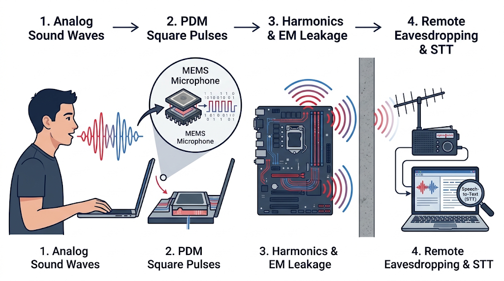
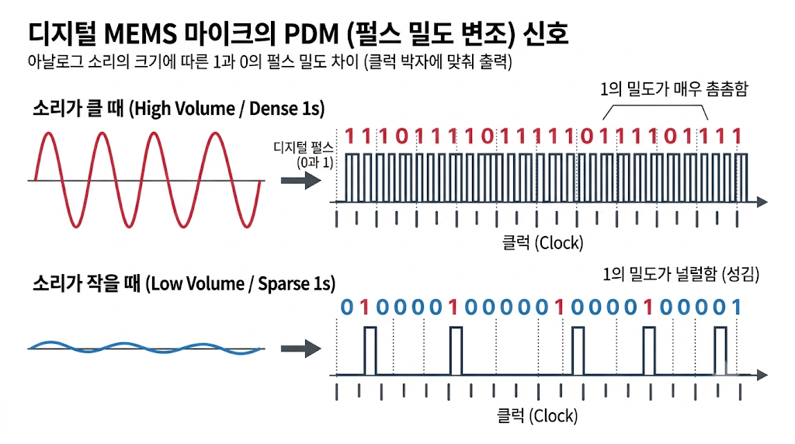

- **논문:** *Sound of Interference: Electromagnetic Eavesdropping Attack on Digital Microphones Using Pulse Density Modulation*
- **학회·연도:** USENIX Security Symposium 2025
- **저자:** Arifu Onishi, *The University of Electro-Communications*; S. Hrushikesh Bhupathiraju, Rishikesh Bhatt, and Sara Rampazzi, *University of Florida*; Takeshi Sugawara, *The University of Electro-Communications*
- **주제:** 디지털 MEMS 마이크가 소리를 PDM(펄스 밀도 변조)으로 처리할 때 새어나오는 전자파를 수신·복조해, 악성코드나 물리 접촉 없이 벽 너머에서 음성을 도청하는 EM 사이드채널 공격
- **링크:** [https://www.usenix.org/system/files/usenixsecurity25-onishi.pdf](https://www.usenix.org/system/files/usenixsecurity25-onishi.pdf)

## 논문 선정 이유

아직 관심 있는 분야를 정하지 못해서 어떤 논문을 볼지 오랜 기간 고민했다. 그러다 우연히 인스타에서 블루투스 패킷을 탐지하는 릴스를 보고 '어? 이거 재밌어 보이는데?' 하는 생각에 블루투스 관련 논문을 찾아봤다. 생각보다 흥미 가는 게 없어서 계속 뒤지다가, 블루투스처럼 '어떤 기기에서 나오는 전파를 수집해 데이터로 만들 수 있지 않을까?' 하는 생각이 들었고, 그 방향으로 찾다가 이 논문을 발견하게 되었다.

## 논문 읽기 전 정리

디지털 마이크가 소리를 처리할 때 전자파가 새어나오는데 그걸 멀리서 주워서 무슨 말을 했는지 복원할 수 있다는 문제인 것 같다. 여기서 말하는 디지털 마이크라는 게 어느 범위까지인지는 모르겠으나, 만약 휴대폰, 컴퓨터에 있는 마이크까지 포함인 거면 특별한 악성코드 없이도 통화 내용을 알 수 있어서 심각한 보안 문제일 것 같다.

## 논문 배경 및 문제의식

옛날에 마이크들은 보통 아날로그 마이크를 썼다. 아날로그 마이크는 소리를 저주파 전압 신호로 그대로 내보내기 때문에 주파수가 낮아 전자파로 멀리 새어나가기 힘들다. 그래서 전자파를 이용한 음성 도청은 큰 위협이 되지 못했다.

그런데 최근 컴퓨터나 휴대폰에 말을 통해서 업무를 보는 일이 많아졌다. 온라인 회의, 전화, LLM에게 명령 등 음성을 쓰는 상황이 늘어나면서 마이크를 단 기기도 많아졌다. 이 때 많이 쓰이는 마이크가 디지털 MEMS 마이크이다. 이 마이크는 PDM이라는 기술을 사용한다. PDM이란 아날로그 소리 신호를 디지털 영역의 출력 펄스 밀도로 변환하는 기술이다.

사실 전자파를 이용한 도청 연구는 기존에도 있었으나 화면이나 키보드처럼 고주파로 동작하는 기기에서만 가능했고 소리는 저주파라 공격이 어려웠다. 게다가 소리를 노린 공격마저도 스피커나 특정 칩에만 적용돼서, 정작 노트북이나 IoT에 흔한 디지털 마이크는 제대로 다뤄지지 않았다.

이 논문은 바로 이 허점을 파고든 SoI(Sound of Interference)라는 공격을 제안했다. SoI는 PDM 디지털 마이크가 소리를 네모 펄스로 내보내는데 이 펄스가 네모이기 때문에 전자파가 광대역으로 고조파들을 방출하게 된다. 그리고 이 고조파마다 원본 소리가 실려 있어서, 공격자가 그중 잘 잡히는 고조파 하나를 골라 FM 복조만 하면 원본 오디오를 복원할 수 있다.

이 공격이 심각한 이유는 악성코드를 심거나 기기에 직접 접근하지 않고도 옆방 벽 너머에서 수동으로 전자파만 주워서 도청할 수 있기 때문이다. 심지어 사용자가 예를 들어 디스코드 통화를 하고 전화를 끊거나 중간에 마이크를 잠그면 보통 마이크가 꺼졌다고 생각을 한다. 하지만 이것은 프로그램 내에서 마이크가 꺼진거지 하드웨어에서 꺼진것이 아니라 이때 혼잣말을 한다거나 다른 말을 했을때에도 도청이 가능하다는 점이다! (이게 이 논문에서 놀라웠음;;)

## 기존 공격 방식의 한계

### 광학 (Optical)

- 대표 연구: 레이저 마이크, Lamphone(진동하는 전구), The Little Seal Bug(캔 등 반사체), Glowworm(전원 LED 밝기), 고속카메라·롤링셔터 기반
- 한계: 대상을 직접 봐야 하거나(가시선), 음원 근처에 진동하는 물체가 있어야 한다

### 레이더 (MmWave)

- 대표 연구: Mmspy, Mmeve, VibSpeech, Milliear, MmEavesdropper
- 한계: 복원한 소리의 명료도가 낮고, 콘크리트 벽을 뚫지 못한다

### 모션센서 (Motion Sensor)

- 대표 연구: Gyrophone(자이로·가속도계), Hard Drive of Hearing(HDD 내부 센서)
- 한계: 센서 값을 읽으려면 대상 기기에 악성코드를 설치해야 한다

### EM / TEMPEST

- 대표 연구: van Eck(1985, 모니터 복원), TEMPEST Comeback(온칩 커플링), MagEar(헤드폰 스피커 전자석), Periscope(헤드폰 케이블)
- 한계: 출력이 큰 스피커에서만 가능해 마이크엔 약하고, TEMPEST Comeback은 아날로그·디지털이 통합된 SoC에서만 동작한다

## 핵심 아이디어와 공격 방식

### 1. 공격 개요와 공격자 설정

기존 공격들은 가시선이나 스피커와 근접해야한다거나 악성코드가 필요하는 등 제약 조건들이 있었는데 SoI 이거를 PDM 디지털 통신의 오프칩 누설로 극복했다.

공격자는 기기를 건드릴 필요없이 근처나 옆방에 안테나를 공격자 기기 방향으로 두면 된다. 대상과의 같은 기종을 사서 취약 주파수를 미리 찾아낼 수 있지만 무조건 그럴 필요는 없다.

### 2. 단계별 누설 원리

피해자가 마이크를 사용을 하게 되면 PDM 마이크에서 네모 펄스가 나온다. 이 네모 펄스에서 클럭의 정수배 고조파가 수백 MHz까지 전파로 샌다. 가장 고조파가 많이 새는 부분은 마이크에서 메인보드 사이에 있는 비차폐 케이블에서 방사된다.

단계별로 설명을 해보면

**1단계**

사람이 말을 하면 공기 진동, 즉 아날로그 소리가 노트북 마이크로 들어간다. 이 소리는 부드러운 파형이고 주파수가 낮다. 이 자체로는 전파가 멀리까지 새어나갈 수 없다. (과거에 공격대상이 아닌 이유)

**2단계**

노트북 안에 있는 디지털 MEMS 마이크가 사람의 소리를 받아 내장 ΔΣ ADC로 0과 1로 된 네모 펄스(PDM)로 바꾼다. 이때 소리의 크기는 1이 나오는 밀도로 표현되고, 출력은 마이크에 공급되는 클럭 박자에 맞춰서 나온다.

**3단계**

이 네모 신호가 수학적으로 기본파와 정수배의 합이다.(푸리에 변환) 그렇기에 전파로 나갈 때 클럭 주파수의 정수배(고조파)가 수백 MHz까지 광대역으로 새어나갈 수 있게 된다. 특히 마이크에서 메인보드까지 잇는 비차폐 케이블이 이 전파를 방사한다. 그리고 원본 소리는 이 고조파들에 FM(주파수 변조) 형태로 실려 있다.

**4단계**

이 전파는 벽도 통과할 수 있어서 공격자는 악성코드나 접촉, 가시선 없이도 옆방에서 안테나로 전파를 받을 수 있다. 수백 MHz에 퍼진 고조파 중에 잘 잡히는 하나를 골라 좁은 sub-band(약 30kHz)를 FM 복조하면 원본 소리가 복원된다. 모든 비트를 복원할 필요가 없다. 복원한 소리는 음성인식(STT)에 넣으면 이 친구들이 이해할 수 있을 정도이다.

### 3. 시뮬레이션으로 타당성 확인

저자들은 이 공격이 실제로 가능한지 시뮬레이션과 실제 기기 양쪽에서 검증했다. 원본 소리가 누설 전파를 따라 변하고 그 전파를 FM 복조하자 원본이 그대로 복원되는 것을 확인했다. 또 서로 다른 고조파(예: 27.7MHz, 701.5MHz)를 복조해도 같은 소리가 나와서 아무 고조파나 골라도 된다는 점을 보였다. 특수 장비 없이 평범한 라디오 수신기로 복원이 됐고 취약 주파수는 수신기의 자동 스캐너로 쉽게 찾았다. 무엇보다 복원 음질이 놀라웠는데 잡음 제거나 추가 학습 없이도 EM으로 복원한 소리의 단어 오류율(WER)이 3.8~7.2%로, 깨끗한 원본 음원(2.6~4.6%)과 거의 차이가 없었다.

결국 SoI는 벽 너머에서 기기에 접촉하지 않고 악성코드도 없이 일반 장비만으로 도청을 가능하게 했다. 앞서 본 기존 공격들의 제약(가시선·근접·악성코드·특정 칩)을 모두 넘어선 것이다.

### 4. 실제 기기 실험으로 검증

위에서의 내용들은 시뮬레이션이였고 이제 진짜로 그게 현실에서 가능한지 확인해봐야한다. 그래서 저자들은 통제된 실험실 환경에서 이 공격이 실제로 작동하는지 확인해봤다.

마이크에서 새어 나오는 전자기 신호를 스펙트럼 분석기로 넓은 주파수 대역(25~512MHz)에 걸쳐 훑어보니 클럭 고조파 주변에 오디오 정보를 담은 누설 피크가 실제로 존재했다. 그리고 이 중 아무거나 하나를 골라 FM 복조를 했더니 디지털 비트를 하나하나 복원하지 않고도 원래 목소리가 그대로 되살아났다. 즉 “PDM 네모 펄스의 고조파가 소리를 가지고 새어나간다.”는 가설이 추측이 아니라 측정으로 확인되었다. 복원한 소리를 EM 신호에 맞춰 따로 학습시키지 않은 상용 음성인식 API에 그대로 넣었을 때도 실제 영어 문장(Harvard Sentences)의 단어 오류율이 14% 수준으로 나와 공격자가 특별한 기술 없이 시중 도구만으로도 말을 알아들을 수 있음을 보였다.

## 실제 환경에서의 공격 성능과 한계

### 1. 실제 공격 시나리오

실험실에서 능력이 확인됐으니 이제 진짜 문제는 "현실에서 되느냐"이다. 저자들은 공격 조건을 점점 나쁘게 만들어가며 공격이 버티는지 확인했다. 먼저 벽이 있는 상황인데 같은 조건에서 일반 고성능 마이크로 녹음했을 때는 단어 오류율이 99.9%로 사실상 아무것도 복원하지 못한 반면 SoI는 6.5%까지 떨어뜨리며 거의 완벽하게 말을 복원했다. 벽이 소리는 막지만 전자기 누설은 막지 못한다는 것이 이 대조에서 분명하게 드러난다. 게다가 비싼 전문 안테나가 아니라 구리 테이프로 대충 만든 안테나로도 분류 정확도가 94% 이상 나왔고, 벽에서 2m나 떨어진 거리에서도 96%를 유지했다. 이 거리는 대상 주파수의 파장(약 65cm)보다 훨씬 길어서, 근거리장뿐 아니라 원거리장으로도 누설이 뻗어나간다는 뜻이다. 심지어 석고보드보다 두꺼운 25cm 콘크리트 벽 너머에서도 94.2%의 정확도가 나왔고 노트북뿐 아니라 스마트스피커 같은 여러 소비자 기기에서도 똑같이 취약점이 재현됐다.

### 2. 한계

물론 모든 기기가 똑같이 뚫리는 것은 아니다. 대표적으로 Jabra 헤드셋은 벽 너머 상황에서는 거의 복원이 되지 않았는데 왜냐하면 기기 내부의 마이크 케이블이 짧아서 안테나 역할을 제대로 하지 못하기 때문이다. 또 공격이 안정적으로 되는 거리는 대략 2m 이내로 제한되고 FM 복조의 포획 효과 때문에 신호가 충분히 강하지 않으면 어느 순간 급격히 복원이 무너진다. 결국 이 공격은 강력하지만 거리와 신호 세기, 기기 설계라는 조건에 어느 정도 묶여 있다는 점도 함께 봐야 한다.

## 어떻게 막을 것인가

그렇다면 이 공격은 어떻게 막을 수 있을까. 가장 먼저 떠올릴 수 있는 건 케이블을 차폐하는 것이지만 PDM 신호가 워낙 넓은 대역에 걸쳐 고조파를 뿜어내기 때문에 모든 주파수를 다 가리지는 못해 충분하지 않다. 다음으로 소프트웨어적으로 오디오의 샘플링 레이트를 바꾸거나 무작위로 흔드는 방법(샘플링 랜덤화)을 생각해볼 수 있는데 저자들이 실제로 8kHz부터 48kHz까지 여러 값으로 바꿔가며 실험해보니 숫자 인식 정확도나 단어 오류율이 거의 변하지 않았다. 왜냐하면 누설이 애초에 오디오를 샘플링하는 단계보다 앞선 하드웨어 단계에서 일어나기 때문에 그 뒤에 샘플링을 아무리 건드려봤자 소용이 없는 것이다.

결국 통하는 방어는 문제의 근원인 클럭을 건드리는 방법이었다. 저자들은 확산 스펙트럼 클럭(SSC)이라는 방식을 제안하는데 클럭에 일부러 무작위 떨림을 줘서 고조파의 위치가 계속 움직이게 만드는 것이다. 이렇게 하면 공격자가 노리던 좁은 대역의 반송파가 가만히 있지 않고 움직이는 표적이 되어버려 FM 복조가 제대로 되지 않는다. 실제로 클럭 편차를 1.0%까지 주자 공격으로 복원한 소리의 품질(STOI)이 0.72에서 0.05로 폭락했는데 정작 정상적인 마이크 녹음 품질은 0.98 수준으로 거의 그대로였다. 즉 마이크 본래 기능은 멀쩡히 유지하면서 공격만 무력화할 수 있다는 뜻이다.

**느낀점**

이번 활동을 통해 논문을 처음으로 읽어보았다. 영어 논문이라 번역하면서 읽어도 매 문장마다 모르는 단어가 너무 많이 나와 진도가 안나갔다. 한 단어를 몰라서 검색해보면 그 단어를 설명할때 쓰이는 단어를 모르고 또 그 단어를 설명해주는 단어들을 모르니까 계속 공부하게 되었다. 특히나 논문 주제가 뭔가 컴퓨터 내의 시스템을 해킹하는(?) 형식이 아닌 현실의 기기에서 파생되는 문제를 다룬 논문이라 뭔가 기계공학과나 전자공학과 사람들이 공부하는 내용들을 더 많이 공부했던 시간이였던거 같다.

하지만 이런 여러 공부들을 하면서 느낀점은 ‘진짜 너무 신기하고 재밌다’라는 생각이 들었다. 상상치도 못한 현실 취약점으로 문제가 생긴다는게 그리고 디지털 마이크는 컴퓨터, 휴대폰, IoT기기 등 현대사회에서 안쓰이는 곳이 없는 장치인데 이렇게 나의 삶과 가까운거에 취약점이 있었다는게 너무 흥미로웠다.

이 논문을 읽으면서 하드웨어나 IoT 보안에 관심이 생겼다. 컴퓨터 속, 인터넷 세상에 있는 취약점도 좋지만 현실에서 사용하는 기기들에서의 취약점을 찾는것도 상당히 재밌는 분야라고 느꼈다.

추후 활동으로 EM Eye나 Screaming Channels 같은 관련 전자기 부채널 논문도 이어서 읽어보고 싶다. 그리고 논문에서 다뤘던 내용으로 직접 실습을 해보고 싶다는 생각이 들었다. 저자들이 수집한 데이터와 복원, 평가 코드를 Zenodo에 공개해두어서, 안전한 환경에서 복원 과정을 직접 재현해보고 싶다는 생각이 들었다.

